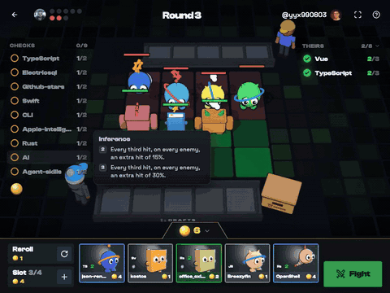
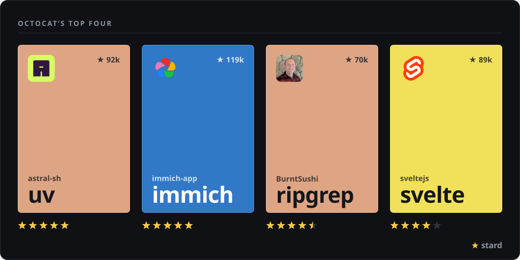
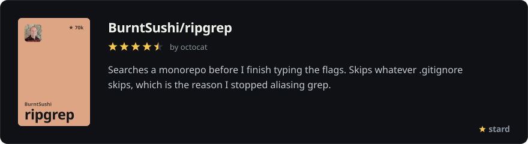
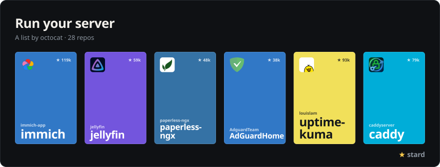
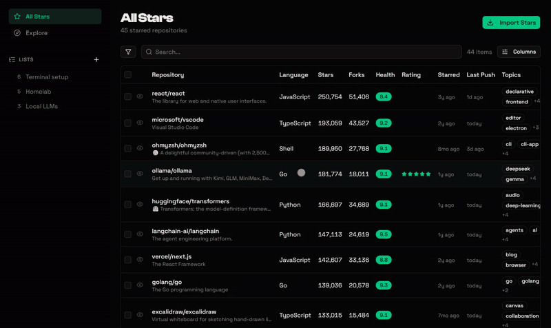
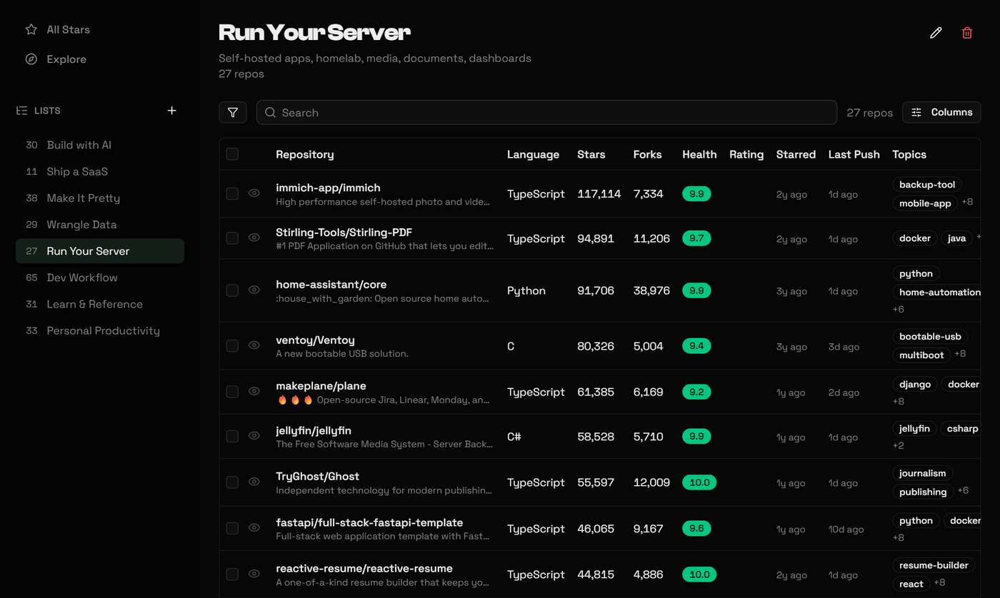

<h1 align="center">Stard</h1>

<p align="center"><b>A card battle built from your GitHub stars</b></p>

<p align="center">Every repo you've starred is a card. Build a team and beat other developers. No signup.</p>

<p align="center">
  <a href="https://stars-demo.armanckeser.com/run"></a>
</p>

<p align="center">
  <a href="https://stars-demo.armanckeser.com/run"></a>
</p>

<p align="center">
  <a href="https://stars-demo.armanckeser.com/compose">Make your profile</a> ·
  <a href="https://www.npmjs.com/package/github-stars-organizer">npm</a> ·
  <a href="AGENT-API.md">Agent API</a> ·
  <a href="#option-b-self-host-with-docker">Self-host</a>
</p>

- Type a GitHub username, no sign-in. The shop deals cards from that account's stars for the day.
- Buy cards onto your Drafts shelf, drag them onto your half of the board, then press **Fight**. Every card acts at once.
- Cards that share a language or topic make a set, ticked off like a pull request's checks. After rounds 2 and 4 you pick one of three boosts.
- 5 wins finishes a run, 3 losses ends one.

## Profile cards

<p align="center">
  <a href="https://stars-demo.armanckeser.com/compose"></a>
</p>

<p align="center">
  <a href="https://stars-demo.armanckeser.com/compose"></a>
</p>

<p align="center"><sub>Put in any GitHub username, no sign-in. If you like Stard, a star helps others find the project.</sub></p>

Your stars say what you actually use, and nobody can see them. Stard turns them into something for your GitHub profile: your top four repos, short reviews in your own words, and your Lists, each drawn as a card.

**1. Pick your top four.** The four repos you would put on a poster. Every repo gets a poster in the colour of its language.

**2. Review what you use.** A rating out of five and a sentence or two. The card links to the repo.

<p align="center">
  
</p>

**3. Show your Lists.** Each GitHub List becomes a card, with the repos folded underneath. Archived and quiet repos are left out, so the list doesn't send people to dead projects.

<p align="center">
  
</p>

**4. Copy the Markdown into your README.** The cards are plain images served from a link, so there is nothing to install or keep running. Paste them into the README of the repo named after your username and they show on your GitHub profile.

Three ways to make one:

- **In the browser.** Open the [demo](https://stars-demo.armanckeser.com/compose), type your username, arrange the sections, copy.
- **With your agent.** `npx skills add armanckeser/github-stars-organizer`, then ask Claude Code or Codex to "make my Stard profile". The agent asks which repos are your favorites and why, and writes the README with you. The **Profile** screen has a copy-paste prompt for agents without skills.
- **On your own machine.** `npx github-stars-organizer` runs the full app on localhost with your [GitHub CLI](https://cli.github.com/) login (`gh auth login`). Ratings and notes you already keep there become your reviews.

## Getting started

### Option A: npx (recommended)

Needs Node.js 20+ and the [GitHub CLI](https://cli.github.com/) logged in. Nothing to host:

```bash
npx github-stars-organizer
```

### Option B: self-host with Docker

Needs Docker and a [classic token](https://github.com/settings/tokens/new?scopes=repo&description=Stars%20Organizer) with the `repo` scope, which is what lets Stard edit your Lists and unstar repos. Stard never reads or changes code; the key icon beside **Import Stars** shows which account and scopes the app is using. No clone:

```bash
GITHUB_TOKEN=ghp_... docker compose -f oci://ghcr.io/armanckeser/github-stars-organizer-stack:latest up -d
```

Open http://localhost:8080 and press **Import Stars**. That runs three containers (the app, Postgres and Electric); `ghcr.io/armanckeser/github-stars-organizer:aio` is all three in one, with its data under `/data`:

```bash
docker run -d -p 8080:8080 -v stars-data:/data -e GITHUB_TOKEN=ghp_... ghcr.io/armanckeser/github-stars-organizer:aio
```

The token can unstar repos and edit your Lists, so anyone who can reach the port can too. Set `AUTH_PASSWORD` to require a password, or sign in through your OIDC provider (Authentik, Authelia, Pocket ID...) with `AUTH_ENABLED=1` and the `OIDC_*` settings in [docker-compose.selfhost.yml](docker-compose.selfhost.yml). Or leave both unset behind a proxy that already checks who gets in.

**From your server's app store:** add the catalog once, then install Stard like any other app.

| Server | Where | Paste |
| --- | --- | --- |
| Cosmos | Market → Sources → Add Source | `https://armanckeser.github.io/selfhost-apps/servapps.json` |
| CasaOS / ZimaOS | App Store → Add Source | `https://github.com/armanckeser/selfhost-apps/archive/refs/heads/casaos.zip` |
| Runtipi | Settings → App Stores → Add App Store | `https://github.com/armanckeser/selfhost-apps` |
| Portainer | Settings → App Templates → URL | `https://armanckeser.github.io/selfhost-apps/portainer/templates.json` |

Unraid's Community Apps doesn't list it yet; [selfhost-apps](https://github.com/armanckeser/selfhost-apps#add-the-catalog-to-your-server) has the template to add by hand.

Umbrel isn't listed: Umbrel installs take no settings, and Stard needs the token.

An AI agent can act through the same API as the UI (`/api/*`). With sign-in on, it sends `Authorization: Bearer <AGENT_API_TOKEN>`; set that yourself, or read the one generated on first start from the `instance_secret` table. [AGENT-API.md](AGENT-API.md#self-hosted) lists the routes.

## It also organizes the stars

Stard started as Stars Organizer, and everything from it is still here. I starred hundreds of repos over the years and could never find anything again. GitHub has Lists now, but sorting 500 stars into them one dropdown at a time is pretty much nobody's idea of a weekend, and a good chunk of what I had starred was dead anyway. Stard lets Claude Code or Codex do the sorting, writes the Lists back to GitHub, and gives every repo a health score so the abandoned ones stand out.

<p align="center">
  
</p>

## Compared with the alternatives

|  | GitHub's stars page | [Astral](https://astralapp.com) | [GithubStarsManager](https://github.com/AmintaCCCP/GithubStarsManager) | Stard |
|---|---|---|---|---|
| **Organizes with** | Lists, by hand | Tags, by hand | Its own categories, sorted by an AI with your API key | GitHub Lists, sorted by the Claude Code or Codex you already use |
| **Shows up on GitHub** | Yes | No, tags live in Astral | Yes, Lists sync both ways | Yes, Lists sync both ways |
| **Flags dead repos** | No | No | No | Health score per repo, plus active alternatives for dead ones |
| **Tags, notes, ratings** | No | Tags and notes | Tags | Tags, notes and 1–5 ratings |
| **Extras** | | Rule-based filters | Semantic search, release tracking, repo Q&A | Explore charts of what you starred over time, backups before every launch |
| **How you run it** | Built in | Hosted, or self-host (PHP) | Desktop app or Docker | `npx`, or Docker |

<sub>Based on each project's README and website as of November 2026. Coming from Astral? Stard imports Astral's export: tags become Lists and notes carry over.</sub>

## What's inside

| | |
|---|---|
| **Lists** | Your GitHub Lists, plus a "Not in any list" pile to sort. Every change syncs back to GitHub. |
| **Health score** | 0 to 10 from last commit, closed vs open issues, contributors, star growth and last release. Archived repos score 0. |
| **Similar repos** | For any star, and active alternatives for the ones nobody maintains anymore. |
| **Tags, ratings, notes** | On top of your stars, searchable and filterable. |
| **Explore** | Charts of your stars by language, health and last commit, and what kinds of repos you starred over time. |
| **Profile** | Your top four, your reviews and your Lists as cards for a GitHub README, with archived and quiet repos left out. Copy or download the Markdown. |
| **Play** | A run in the browser: buy cards drawn from your stars, place them on a board, build sets and pick boosts, and fight other teams, until 5 wins or 3 losses. [Play one](https://stars-demo.armanckeser.com/run). |
| **Battle** | Two GitHub usernames, and each one's team of four (an ace they pick and three drawn from their stars each day) fights as trading cards in an arena: level from stars, HP from contributors, attack from commits, type from the language. A repo you own is shiny. Build a character on the Profile screen (a figure, a class with a perk, a motto), paste its card into your README, and the game reads your character from there. From your own copy you can challenge someone to a real match: turn by turn, over hours or days, with a GitHub Discussion on your profile repo as the whole record. Every move is a comment, the dice are public, and nothing is stored anywhere else. [Try one](https://stars-demo.armanckeser.com/battle). The plan for the full game, played in GitHub Discussions, is in [#45](https://github.com/armanckeser/github-stars-organizer/issues/45). |
| **AI sorting** | Claude Code, Codex or any agent that can run `curl` reads your stars, suggests Lists and sorts repos into them once you agree. The robot icon beside **Import Stars** gives you the prompt, or install the skill with `npx skills add armanckeser/github-stars-organizer`. [AGENT-API.md](AGENT-API.md) has the API. |
| **Search for your agent** | `npx github-stars-organizer search pdf parser` lists the stars that match, with their Lists and whether each is still alive. To have Claude Code or Codex check your stars before suggesting a library or tool, add this line to your `CLAUDE.md` or `AGENTS.md`: "Before you suggest a library, tool or GitHub repo, run `npx github-stars-organizer search <a few words>` to check what I already starred. If my pick is quiet or hasn't released in a year, say so and name the current alternative." |
| **Backups** | A backup before every launch, and a restore that only adds back what's missing. |
| **Private** | Talks only to GitHub with your token. No telemetry. |

<p align="center">
  
  <br><sub><b>Lists.</b> The same table inside a List, with a health score on every repo.</sub>
</p>

## Is this for you?

**Yes, if** you have a few hundred stars you never look at, you already use (or want to use) GitHub Lists, or you want to know which of your stars quietly died.

**Not yet, if** you want semantic search over READMEs or release notifications (GithubStarsManager does both), or a hosted site you sign into (Astral has one).

## Contributing

[CONTRIBUTING.md](CONTRIBUTING.md) has the dev setup.

Copyright (C) 2026 Armanc Keser. [AGPL-3.0-or-later](LICENSE), with absolutely no warranty. Not affiliated with or endorsed by GitHub. [Privacy](https://armanckeser.com/privacy#stard) · [Don't want to be played?](OPPONENTS.md#dont-want-to-be-played)
