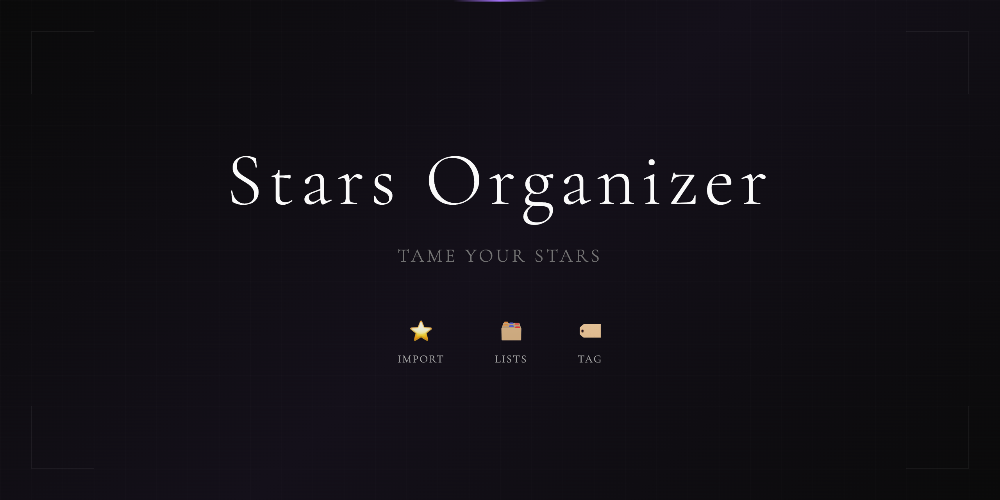
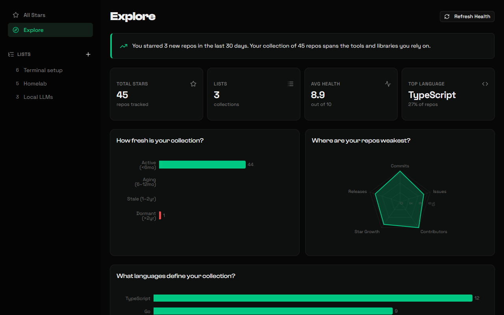

<p align="center">
  
</p>

**Hundreds of GitHub stars and no way to find anything?** Stars Organizer pulls every repo
you've starred into one fast table you can search, tag, rate and annotate, sorts them into
GitHub Lists that sync back to your profile, and scores each repo's health so the abandoned
ones stand out.

**[Try the demo](https://stars-demo.armanckeser.com/)**, no sign-in: it opens on
my public stars and Lists, and loads anyone else's from a GitHub username.
To use it on your own stars, run `npx github-stars-organizer` with the
[GitHub CLI](https://cli.github.com/) signed in. Nothing to host.

<p align="center">
  
</p>

- **Lists that sync to GitHub.** New Lists, deleted Lists and repos you add to a List are
  written back to your GitHub Lists.
- **See what's not in any List.** Filter or group by List, with "Not in any list" first, so
  sorting a backlog of stars has a starting pile. GitHub's own stars page can't show this.
- **A health score for every repo** from commit recency, issue resolution, contributors,
  star growth and release cadence, so you can tell a living project from a dead one.
- **Your own layer on top:** tags, a 1–5 usefulness rating and free-form notes, stored locally.
- **Explore your collection:** how fresh it is, where your repos are weakest, which languages
  dominate, and when you found them.
- **Unstar** in one click, synced to GitHub.
- **Agent-friendly.** An AI agent can read everything over a read-only SQL role and act
  through the same API as the UI, so "put every archived repo in a *Graveyard* list" is one
  request.

<p align="center">
  
</p>

If Stars Organizer is useful to you, starring the repo helps other people find it, and [armanckeser.com/subscribe](https://armanckeser.com/subscribe) has ways to hear about new releases.

---

## Why This Exists

I have hundreds of starred repos and no good way to organize them. GitHub's native Lists are barely discoverable and there is no tagging, rating, or bulk curation. I wanted a local surface over my stars that an agent could read and help me tidy: sort into Lists, tag by purpose, rate usefulness, and push the results back to GitHub so the organization survives outside this tool.

---

## Run it on your machine

You need Node.js 20+ and the [GitHub CLI](https://cli.github.com/) signed in (`gh auth login`).

```bash
npx github-stars-organizer
```

It opens http://127.0.0.1:5185 in your browser, reads your stars and Lists (private ones too), scores
their health, and stops when you press Ctrl-C. It uses the token `gh` already has; set `GITHUB_TOKEN`
to use a different one. Use `--port` if 5185 is taken.

Lists, List membership and unstars are written to GitHub as you make them. Tags, ratings, notes and
health scores are saved in that browser, for that address, so they are there the next time you run it.
Using a different browser, or a different `--port`, starts from a fresh copy.

The local server only answers requests from its own page, since it can act with your token.

---

## Self-host

You need Docker and a GitHub token. A [classic personal access token](https://github.com/settings/tokens/new?scopes=repo&description=Stars%20Organizer)
with the `repo` scope is enough: it covers reading your stars and Lists, and writing Lists and unstars back.

```bash
git clone https://github.com/armanckeser/github-stars-organizer.git
cd github-stars-organizer
cp server/.env.example server/.env    # set GITHUB_TOKEN=ghp_...
docker compose -f docker-compose.prod.yml up -d --build
```

Open http://localhost:5184 and press **Import Stars** to pull in your stars (a few hundred repos take under a minute).
Postgres applies `schema.sql` on first start, so there is no migration step.

Four containers: Postgres, ElectricSQL, the Hono API and nginx serving the app. Only nginx publishes a
port (5184); put it behind your reverse proxy (Caddy, Traefik, Nginx Proxy Manager, Cosmos) and add
auth there, since the app itself has no login: whoever can reach it can act with your token.
Change the published port in `docker-compose.prod.yml` if 5184 is taken. Updating is `git pull` and
the same `up -d --build`.

---

## Development

### Prerequisites

- Docker (Postgres + ElectricSQL)
- Node.js 20+
- A GitHub personal access token with the `repo` scope

### Quick Start

```bash
cp .env.example .env
cp server/.env.example server/.env
# edit server/.env and set GITHUB_TOKEN to a real PAT

docker compose up -d          # Postgres (:5433) + ElectricSQL (:3000)

cd server && npm install && npm run dev   # Hono API on :4000
npm install && npm run dev                # Vite frontend on :5173
```

Apply the schema once Postgres is up:

```bash
PGPASSWORD=password psql -h localhost -p 5433 -U postgres -d app -f schema.sql
```

Then open http://localhost:5173 and import your stars.

### Commands

```bash
npm run lint          # eslint
npm test              # vitest
npm run build         # tsc -b && vite build
npm run build:cli     # the npx package: the app built with VITE_LOCAL=1 + the CLI, into cli/dist
```

To try List and unstar writes without touching a real account, run the fake GitHub in
`scripts/fake-github.ts` and point either server at it:

```bash
npx tsx scripts/fake-github.ts                                       # :4999, state at /__state
GITHUB_TOKEN=fake GITHUB_API_URL=http://127.0.0.1:4999 node cli/dist/cli.js
```

---

## Architecture

```
github-stars-organizer/
├── src/
│   ├── routes/            # index (main table), explore (dashboard), list.$listId
│   ├── components/        # table, views (dashboard/kanban/list), detail sheet, ui
│   ├── db/                # PGlite + Electric provider
│   └── lib/
│       ├── mode.ts        # build mode: server (self-host), demo, or local (npx)
│       ├── collections.ts # TanStack DB collections, one per table, with each mode's writes
│       ├── import-plan.ts # local mode: folds a GitHub read into what the browser stored
│       └── api.ts         # browser -> API fetch wrapper
├── server/
│   ├── index.ts           # Hono API: GitHub sync + business logic + Electric proxy
│   └── github.ts          # every GitHub call, shared with the CLI
├── cli/                   # the npx package: localhost server holding the gh token
├── schema.sql             # Postgres schema
└── docker-compose.yml     # Postgres + ElectricSQL
```

**Reads and writes are separated.** An agent reads the database directly over a read-only SQL connection. All writes go through the Hono API so the GitHub sync and validation run; nothing writes to Postgres as a superuser.

**Electric drives the UI.** ElectricSQL streams Postgres shapes into the browser through an API proxy. TanStack DB turns each table (`repos`, `lists`, `list_items`, `tags`, `repo_tags`) into a live collection, and the React UI re-renders on change.

**The npx build keeps the data in the browser.** Built with `VITE_LOCAL=1`, the same collections persist in an OPFS SQLite database instead of streaming from Postgres. The CLI's localhost server holds the token and only makes GitHub calls; each launch re-reads GitHub and keeps the browser's tags, ratings and notes.

**The schema is the source of truth.** Tables use UUID primary keys and are defined in `schema.sql`; drizzle-orm config is available for schema tooling.

---

## Tech Stack

| Layer      | Technology                                             |
|------------|--------------------------------------------------------|
| UI         | React 19, TypeScript, Vite, Tailwind v4, shadcn        |
| State      | TanStack DB, TanStack Router, TanStack Table           |
| Sync       | ElectricSQL (@electric-sql/client, pglite)             |
| API        | Hono                                                    |
| Data       | Postgres 16, drizzle-orm                                |
| GitHub     | @octokit/rest, GitHub GraphQL API                      |

---

## License

Released under the GNU Affero General Public License v3.0 — see [LICENSE](LICENSE). If you run a modified version where other people can reach it, the AGPL asks you to publish your changes too.
