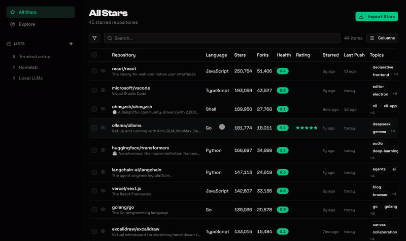
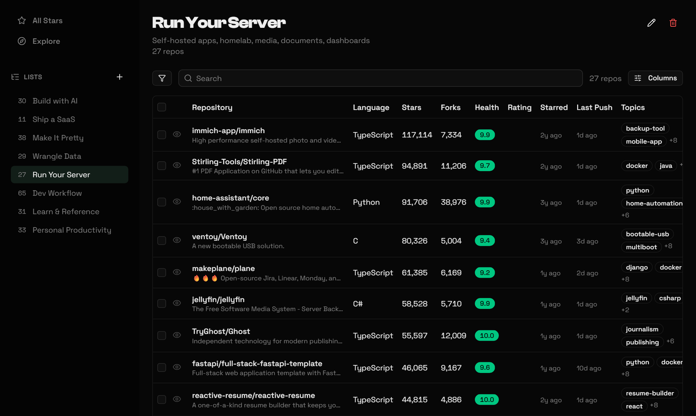

Search, tag, rate and sort your GitHub stars into Lists that sync back to GitHub.

```bash
npx github-stars-organizer
```

Uses your [GitHub CLI](https://cli.github.com/) login (`gh auth login`). Nothing to host.
Or **[try the demo](https://stars-demo.armanckeser.com/)**, no sign-in.

<p align="center">
  
</p>

- **Lists that sync to GitHub**, plus a "Not in any list" pile to sort.
- **A health score per repo**, so dead projects stand out. Click a bar on Explore to see those repos.
- **Similar repos** for any star, and active alternatives for the ones nobody maintains anymore.
- **Tags, ratings and notes** on top of your stars.
- **Backups before every launch**, and a restore that only adds back what's missing.
- **Private:** talks only to GitHub with your token. No telemetry.

<p align="center">
  
  <br><sub><b>Lists.</b> The same table inside a List, with a health score on every repo. Lists sync back to GitHub.</sub>
</p>

**Sort hundreds of stars with an AI agent.** Claude Code, Codex or any agent that can run `curl` reads your stars, suggests Lists and sorts repos into them once you agree. The robot icon beside **Import Stars** gives you the prompt to paste; [AGENT-API.md](AGENT-API.md) has the API for both the `npx` version and a self-hosted install.

**GitHub token:** the `npx` version uses your GitHub CLI login. Self-hosted needs a [classic token](https://github.com/settings/tokens/new?scopes=repo&description=Stars%20Organizer) with the `repo` scope, which is what lets it edit your Lists and unstar repos. Stars Organizer never reads or changes code; the key icon beside **Import Stars** shows which account and scopes the app is using.

<details>
<summary>Self-host with Docker</summary>

Needs Docker and a [classic token](https://github.com/settings/tokens/new?scopes=repo) with `repo` scope. No clone:

```bash
GITHUB_TOKEN=ghp_... docker compose -f oci://ghcr.io/armanckeser/github-stars-organizer-stack:latest up -d
```

Open http://localhost:8080 and press **Import Stars**. That runs three containers (the app, Postgres and Electric); `ghcr.io/armanckeser/github-stars-organizer:aio` is all three in one, with its data under `/data`:

```bash
docker run -d -p 8080:8080 -v stars-data:/data -e GITHUB_TOKEN=ghp_... ghcr.io/armanckeser/github-stars-organizer:aio
```

The token can unstar repos and edit your Lists, so anyone who can reach the port can too. Set `AUTH_PASSWORD` to require a password, or sign in through your OIDC provider (Authentik, Authelia, Pocket ID...) with `AUTH_ENABLED=1` and the `OIDC_*` settings in [docker-compose.selfhost.yml](docker-compose.selfhost.yml). Or leave both unset behind a proxy that already checks who gets in.

**From your server's app store:** add the catalog once, then install Stars Organizer like any other app.

| Server | Where | Paste |
| --- | --- | --- |
| Cosmos | Market → Sources → Add Source | `https://armanckeser.github.io/selfhost-apps/servapps.json` |
| CasaOS / ZimaOS | App Store → Add Source | `https://github.com/armanckeser/selfhost-apps/archive/refs/heads/casaos.zip` |
| Runtipi | Settings → App Stores → Add App Store | `https://github.com/armanckeser/selfhost-apps` |
| Portainer | Settings → App Templates → URL | `https://armanckeser.github.io/selfhost-apps/portainer/templates.json` |

Unraid's Community Apps doesn't list it yet; [selfhost-apps](https://github.com/armanckeser/selfhost-apps#add-the-catalog-to-your-server) has the template to add by hand.

Umbrel isn't listed: Umbrel installs take no settings, and Stars Organizer needs the token.

An AI agent can act through the same API as the UI (`/api/*`). With sign-in on, it sends `Authorization: Bearer <AGENT_API_TOKEN>`; set that yourself, or read the one generated on first start from the `instance_secret` table. [AGENT-API.md](AGENT-API.md#self-hosted) lists the routes.
</details>

Developing: [CONTRIBUTING.md](CONTRIBUTING.md). Like it? A star helps others find it.

Copyright (C) 2026 Armanc Keser. [AGPL-3.0-or-later](LICENSE), with absolutely no warranty. Not affiliated with or endorsed by GitHub.
