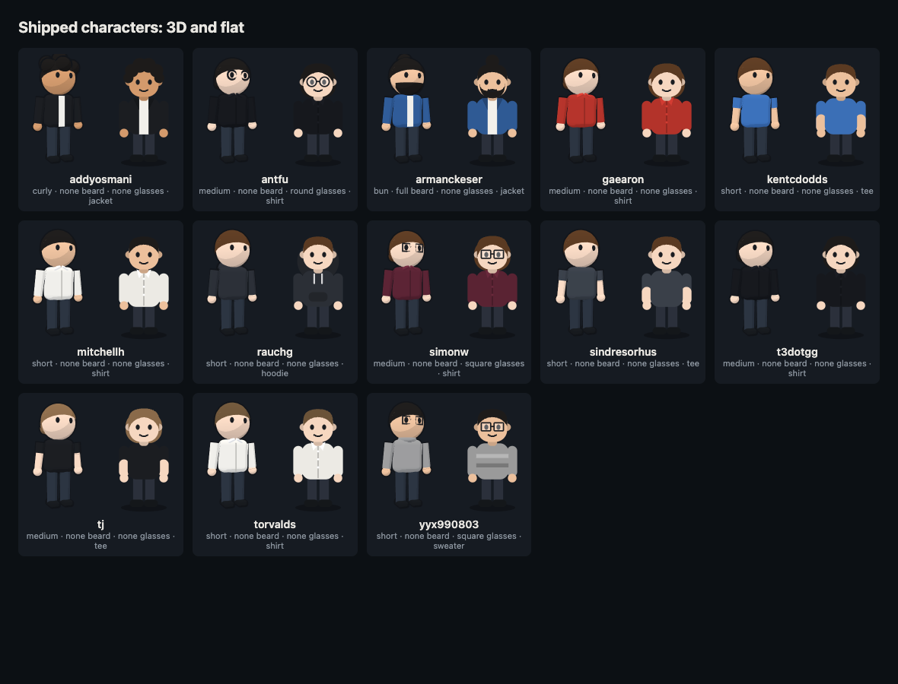

# Characters

How a player looks in Stard: the figure behind their cards in a battle, on the board in a run, and on their trainer card. One file per GitHub account, `characters/<login>.md`, login in lower case.



The picture comes from `npx vite scripts/character-gallery`.

## Change or remove your file

The files for the accounts in [OPPONENTS.md](../OPPONENTS.md) are drawn by hand from each account's public avatar, with plain parts only: hair, glasses, top and colours.

- Change it: add a file `character.md` with the keys below to a public repo of your own called `stard`. Your own file always wins over the one here.
- Remove it: open an issue (https://github.com/armanckeser/github-stars-organizer/issues/new?title=Remove%20my%20character) or message the owner on GitHub, and the file is deleted.
- An account that opted out of being played ([OPPONENTS.md](../OPPONENTS.md#dont-want-to-be-played)) never shows the file here.

The game reads, in this order: `character.md` in your `stard` repo, then a trainer card in your `stard` or profile README, then the file here, then a look made from your username.

## The keys

Plain `key: value` lines. Every key is optional. Unknown keys and values are ignored.

```
name: Theo
class: scout
motto: Ship it.
skin: light
hair: short
hair-color: brown
beard: stubble
glasses: round
hat: none
headphones: no
top: hoodie
top-color: #1f1f1f
```

| Key | Values |
|---|---|
| `name` | Up to 24 characters |
| `class` | `maintainer`, `scout`, `collector`, `specialist`, `veteran`, `archivist` |
| `motto` | Up to 70 characters |
| `skin` | `light`, `fair`, `tan`, `brown`, `deep`, or `#rrggbb` |
| `hair` | `bald`, `buzz`, `short`, `side-part`, `medium`, `long`, `curly`, `bun`, `mohawk` |
| `hair-color` | `black`, `brown`, `blonde`, `red`, `grey`, `blue`, or `#rrggbb` |
| `beard` | `none`, `stubble`, `full`, `goatee`, `moustache` |
| `glasses` | `none`, `round`, `square`, `shades` |
| `hat` | `none`, `cap`, `beanie` |
| `headphones` | `no`, `yes` |
| `top` | `tee`, `hoodie`, `jacket`, `sweater`, `shirt` |
| `top-color` | `green`, `blue`, `purple`, `red`, `orange`, `yellow`, `charcoal`, `white`, or `#rrggbb` |

Beard, glasses, hat and headphones left out mean none. Any other key left out comes from the look made from the username.
